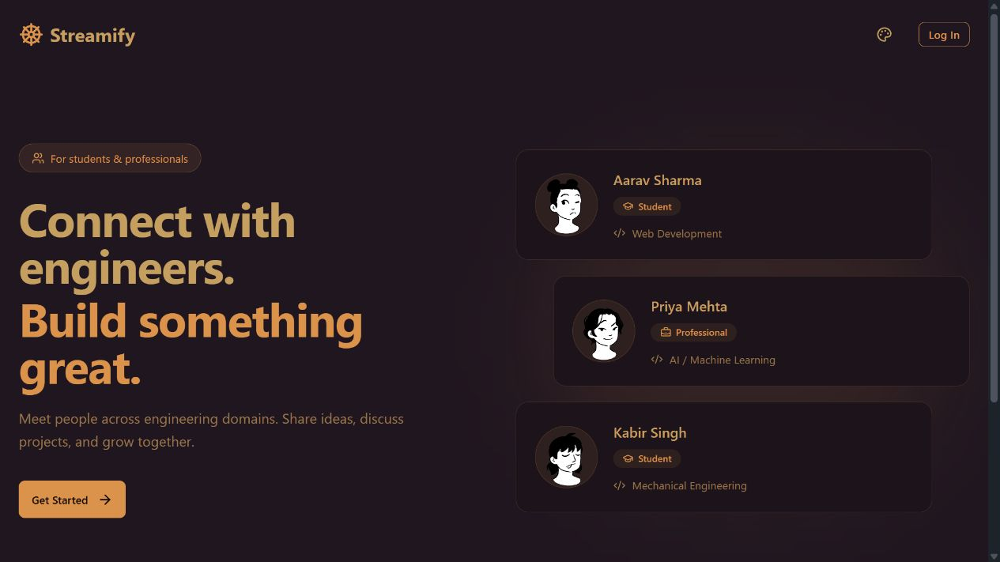

# Streamify

An engineering networking application where students and professionals can discover peers, send connection requests, and chat.

## Interface

Screenshot of the local application; the landing page includes demonstration engineer profiles.

## Features

- Sign-up, login, and profile onboarding
- Engineering domain and career-stage profiles
- Recommended engineers and connection requests
- Real-time messaging through Stream Chat
- Theme selection across the interface

## Stack

React, Vite, Tailwind CSS, DaisyUI, TanStack Query, Zustand, Express, MongoDB, Mongoose, JWT cookies, and Stream Chat.

## Run locally

Use Node.js compatible with Vite 8 and a MongoDB instance. Create a Stream Chat application for messaging.

1. In `backend`, run `npm ci`, copy `.env.example` to `.env`, fill in your credentials, then run `npm run dev`.
2. In `frontend`, run `npm ci`, copy `.env.example` to `.env`, set the matching Stream API key, then run `npm run dev`.
3. Open `http://localhost:5173`. The frontend expects the API at `http://localhost:5001/api`.

Build the frontend with `npm run build` inside `frontend`.

## Project structure

- `frontend/src/pages`: landing, authentication, onboarding, connections, and chat screens
- `frontend/src/components`: reusable cards, navigation, and theme controls
- `backend/controllers`: authentication, users, connections, and chat logic
- `backend/models`: MongoDB user and connection-request models

## Status

Development project; not deployed. Environment files, dependency folders, and local Git history are excluded from this repository. Existing application code is preserved as a source snapshot.
